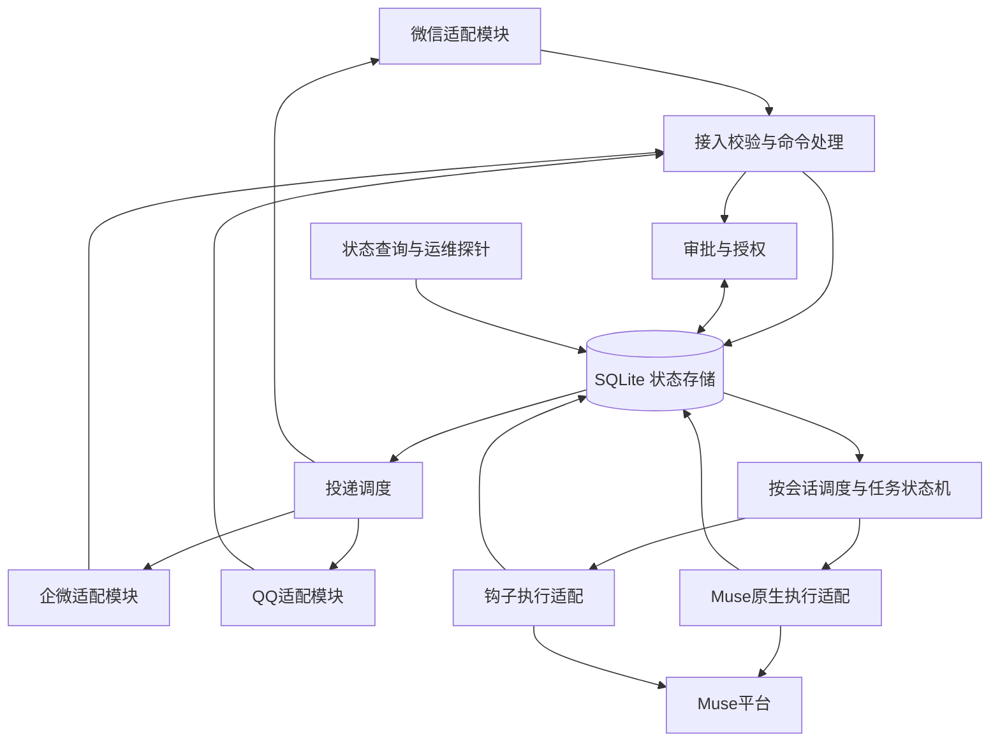
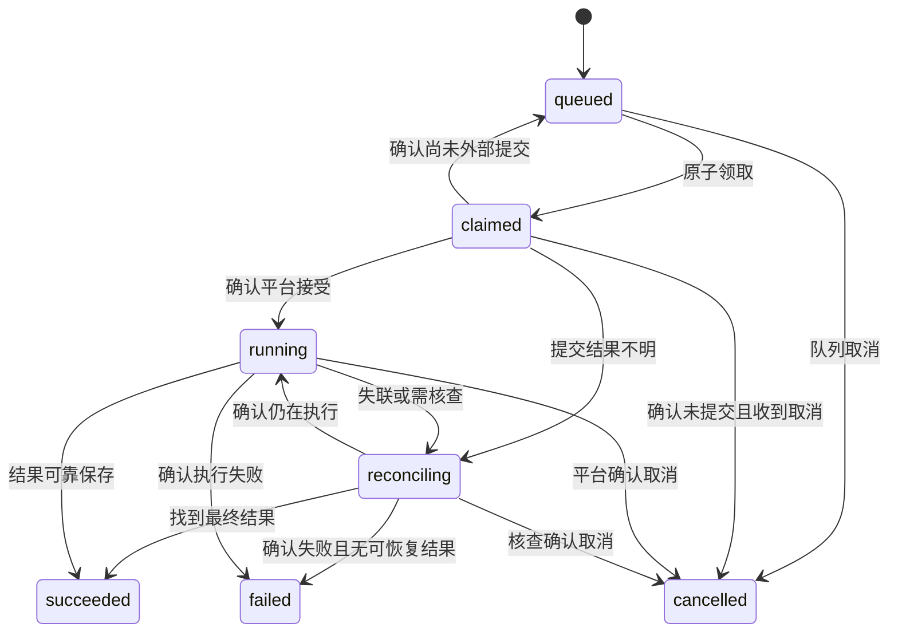

# muse-mobile-channels 整体架构改造方案

日期：2026-10-29  
评估基线：`f05c964`  
状态：设计草案；本方案未实施，生产部署须另行确认。

## 1. 目标与现状

本项目负责连接微信、企业微信与 Muse，后续增加 QQ。改造目标是将消息接入、会话调度、任务执行、结果投递和审批授权形成明确的职责分工，降低丢消息、重复执行、跨会话串线和故障恢复的复杂度。

保留已有渠道协议、媒体处理与可验证的业务行为，逐步迁移持久化和调度。继续采用 Python、单机本地存储与多个受监督进程，暂不引入 Redis、Kafka、微服务或多机调度。SQLite 仅部署在同一主机的本地文件系统，不用于跨机器共享目录。

现有问题来自已阅读的代码和故障复现，尚无生产负载数据，不能据此认定吞吐量不足：

| 现有结构 | 影响 | 改造方向 |
| --- | --- | --- |
| inbox、spool、seen、offset、retry 等文件分别提交 | 操作部分成功后难以判断应重试还是跳过 | 事务提交消息、任务及发件状态 |
| 网关、原生桥和钩子分别管理部分任务生命周期 | 取消、续跑、完成判定可能不一致 | 统一状态机与任务所有权 |
| 原生桥按渠道维护 worker 与 Muse session | 多人、多群扩展时存在共享上下文风险 | 按机器人账户和会话隔离 |
| 两个网关各约 4,500–4,800 行，钩子各约 2,200 行 | 协议与业务混杂，跨渠道修复容易遗漏 | 渠道适配与共享业务模块分离 |
| 固定部署路径、导入时读取配置和平台依赖 | 干净环境测试困难，迁移依赖机器布局 | 显式配置与依赖注入 |
| 健康信息散布在服务状态、心跳与多个文件 | 进程在线不等于任务可执行、回复可送达 | 分层健康检查与可追溯事件 |

此前 `7e347e6` 已修复的消息去重、重试落盘、队列恢复和单渠道审批问题，属于本次改造必须保持的回归基线。

## 2. 目标架构与职责



### 2.1 渠道适配模块

每个渠道负责认证、连接、平台事件解析、媒体协议、发送能力与平台限流，不决定任务是否重跑、是否完成，也不直接操作其他模块的状态文件。

统一入站消息携带 channel、account_id、chat_type、external_chat_id、external_message_id、sender_id、text、media_refs 和 received_at。引用原文作为显式上下文输入。渠道原始敏感字段只在适配模块内使用，不默认写入任务事件日志。

统一出站能力接收确定的路由、消息内容、稳定的逻辑发送 ID 与分段信息，返回成功、临时失败、永久拒绝或结果不明。每个渠道声明支持的媒体类型、长度、主动发送及回复窗口限制，由投递模块据此选择行为。

### 2.2 接入、命令与授权

接入模块负责消息校验、白名单、消息去重和命令分流。普通消息进入任务队列；管理命令调用核心模块，渠道适配模块只负责展示结果。

统一支持现有 `/ping`、`/status`、`/new`、`/stop`、`/queue` 和审批命令。保留现有渠道特有命令，通过显式能力注册接入，不因重构静默删除。

所有授权由确定的账户、会话、操作者和操作类型共同判断。管理命令与审批不能仅凭可猜测的编号执行。权限不足不创建执行任务，返回明确结果并留下不含正文的审计记录。

### 2.3 调度与执行适配

调度模块是任务状态与执行者选择的唯一负责人。默认同会话 FIFO，每个会话一个已提交或结果不明的活动任务；跨会话并发上限默认 4，可通过配置调整。调度采用会话轮转，避免单个活跃群占满所有名额。

Muse 原生桥与钩子统一实现执行接口：提交、查询、取消、接收事件。接口显式区分“确定未提交”“确定已提交”和“提交结果不明”。原生路径确定未提交时，调度模块才能选择钩子；已经提交或结果不明时先核查原执行，不自动创建第二份执行。

钩子保留为执行适配方式，停止独立决定重跑、终止和抢占。旧版抢占、分离批次和孤儿补答行为先进入兼容策略，使用特征测试锁定；按渠道切换期间不擅自改变现有语义。新通道采用严格会话 FIFO，任务取消未确认前不释放该会话的执行位置。

### 2.4 投递与审批

投递模块负责发件箱、分段、附件、重试和发送结果；执行模块生成结果时，在同一事务写入结果和待投递记录。执行完成与投递成功分别统计，不能以“回复已入队”当作用户已收到。

审批模块负责审批来源、可决策人、过期时间和决策状态，通知通过同一发件箱发送。单渠道失败不能阻止其他已选择渠道；没有来源时，只向明确配置的管理员目标通知，不广播到所有聊天。

### 2.5 建议目录与部署形态

```text
src/mobile_channels/
  core/           # 消息、会话、任务状态、授权与调度
  storage/        # SQLite、事务、迁移、查询
  channels/       # weixin、wecom、qq 协议与媒体适配
  executors/      # Muse 原生与钩子执行适配
  delivery/       # 发件箱、重试、分段与确认
  approvals/     # 审批生命周期与决策提交
  runtime/        # 配置、进程入口、CLI、健康检查
tests/            # 契约、故障注入、集成与回归测试
```

目录用于限定职责，不要求为每种数据模型增加一层无业务价值的转发。模块通过小接口暴露行为，事务细节由存储模块封装。

网关保持按渠道独立进程；核心调度单实例；原生执行与钩子 worker 可独立运行，投递 worker 可与网关同进程。不同进程通过本机 SQLite 领取和提交工作。systemd 负责重启进程，自愈脚本仅修复已启用服务的安装，不修改任务判定。

## 3. 会话、数据与一致性

### 3.1 会话标识与路由

会话唯一约束为 `(channel, account_id, chat_type, external_chat_id)`，内部使用生成的 conversation_id。私聊以外部用户 ID 标识，群聊以群 ID 标识，群内成员共享群上下文。外部 ID 不直接用作文件路径。

发件目标来自已验证入站路由或管理员明确配置的主动目标；模型不得直接覆盖绑定回复的接收者。Muse session 关联 conversation_id 与 generation，禁止多个不同会话复用同一个活动 Muse session。

`/new` 在事务中增加 generation，新消息绑定新 generation；旧任务保留原绑定与原回复路由，迟到结果标注来源且不得污染新上下文。`/stop`、队列删除与任务查询均限定当前会话，并校验操作者权限。

### 3.2 SQLite 模型

| 表 | 主要用途及约束 |
| --- | --- |
| accounts / conversations | 渠道账户、会话路由、上下文 generation、权限配置引用 |
| inbound_messages | 原消息及接入结果；唯一键为渠道、账户、外部会话、外部消息 ID |
| tasks | 执行状态、会话序号、取消请求、活动 attempt；每条普通入站消息最多一个任务 |
| execution_attempts | 执行方式、提交状态、平台 run/session ID、owner、lease、fencing token |
| task_events | 追加记录状态变化与原因，使用 attempt 内事件 ID 或稳定哈希去重 |
| outbound_messages / outbound_parts | 稳定逻辑发送 ID、目标、正文或附件引用、每段状态和平台回执 |
| approvals / approval_decisions | 来源任务、授权目标、过期与决策提交；原子占用决策权 |
| media_assets | 本地受控路径、类型、大小、引用关系与清理状态 |
| schema_migrations / import_runs | 数据库版本与旧状态导入记录，支持重复校验及审计 |

连接统一启用外键、WAL、`synchronous=FULL` 和 5 秒 busy timeout。事务只包含短时本地操作，禁止在事务中等待网络、媒体下载或 Muse 回复。遇到锁竞争采用有上限的退避；未提交成功不能向上游报告接入或投递交接完成。

入站接收、去重和任务创建在同一事务完成；有协议 ACK 时在提交后确认。附件先以 pending 记录入队，再异步下载，不以下载失败丢弃文字与附件元信息。

执行结果、对应发件记录和状态事件在同一事务写入。平台请求无法纳入数据库事务，因此仍需要处理“外部成功、本地尚未记录”的窗口，SQLite 不提供外部系统 exactly-once 保证。

### 3.3 任务状态与所有权

任务执行状态为 queued、claimed、running、reconciling、succeeded、failed、cancelled；取消请求单独记录。投递状态独立于执行状态。



任务领取使用条件更新，同时检查会话活动位置和全局并发限制。lease 默认 60 秒，worker 每 15 秒更新；每次所有权转移增加 fencing token。所有状态提交检查 owner、attempt 和 token，旧 worker 的迟到事件不能直接覆盖新状态。

lease 过期只代表本地执行者失联，不等于 Muse 任务已终止。已提交任务转 reconciling，根据平台 run/session 查询；查不到或平台不可用时保留待核查状态并告警，不盲目重跑。未提交任务才可重新排队。外部调用无法被数据库 fencing 撤销，故不能单靠 lease 允许重复提交。

取消运行任务先写 cancel_requested，再请求平台取消；收到取消确认或执行结果后终结任务。取消与完成竞争时记录实际确认顺序，已经可靠保存的结果不被迟到取消抹掉。明确手工重跑创建新任务，保留原任务关联和风险提示。

### 3.4 出站与审批的不确定结果

每个发送段具有稳定 ID；状态区分 pending、sending、retry_wait、delivered、delivery_unknown、rejected 和 cancelled。发送前保存 attempt，成功回执后提交 delivered。临时失败退避，永久拒绝记录原因，正式回复不得静默丢弃。

发送请求超时或进程在回执前退出时进入 delivery_unknown。有官方幂等键或可核查回执时查询或复用原标识重试；没有可核查依据时保留未知状态，提供显式重试入口并告知可能重复。不得把“未收到成功”当成“确定没发送”。

审批先验证会话、操作者与时效，在事务中原子领取决策权，再调用 Muse 提交。重复点击返回同一决策状态。提交结果不明先核查平台，不自动改选另一决策。通知失败不会改变审批为已决策。

## 4. 迁移与回退

### 阶段一：锁定行为并建立可测试入口

盘点所有命令、回复闸门、进度、队列、取消和审批行为，建立现有与目标行为对照表。先将路径、配置、时钟、存储和平台客户端改为启动时传入；导入模块不读取生产配置、不访问网络。

将现有故障回归保留为验收基线。新增代码使用包内接口，旧 CLI 和脚本入口保留兼容包装。依赖管理建立统一清单与各通道可选依赖组，首阶段不借机进行重大依赖升级。

### 阶段二：建立存储与只读影子验证

创建带版本的 SQLite schema、事务接口、状态查询与幂等导入器。从旧文件只读导入到影子数据库，比较队列成员、顺序、发送结果和审批状态；影子核心不创建外部执行、不发送消息、不提交审批。

导入以源文件路径、字节区间、内容摘要和导入批次记录，重复运行不能重复创建任务。旧队列解释必须包含 spool_offset、spool_tombstones、parked、partial、取消和管理指令状态，不能只读取 inbox。

已有明确执行绑定的任务导入 running/reconciling；无足够证据的记录导入待核查状态，不能默认重跑。旧回复已成功的标记 delivered；仅有“已入队”证据不标已送达。

### 阶段三：按渠道切换单一写入者

先在沙箱验证，再按“个人微信、企微”的顺序切换；每个渠道独立验收。切换前停止该渠道接入和所有相关调度、投递及审批写入者，等待或标记在途请求结果，做最终快照和增量导入。

校验成功后该渠道切为新核心唯一写入者，旧钩子与旧桥不再执行该渠道。新旧模式使用排他的渠道模式配置与进程锁，启动时检查冲突。禁止新旧业务双写，也禁止双向同步状态文件。

切换后的行为检查：接入能落库、任务只有一个执行者、回复回到原会话、重启后可恢复、审批可核查。失败时暂停新领取并保留接入消息，使用新状态排障；不通过重启反复制造外部请求。

### 阶段四：统一调度并接入 QQ

两条现有渠道稳定后移除兼容期重复的任务判死与独立调度逻辑，将旧脚本缩减为入口和安装工具。QQ 直接实现统一适配接口，复用会话、任务、授权、审批与发件箱。

本方案落地后，QQ 接入文档中“沿用 JSONL 作为权威队列”和“钩子独立调度”的设计应同步调整为 SQLite 与统一调度。QQ 不先复制现有大型网关和钩子。

### 回退规则

启用新核心前可以直接停用影子模式。启用后旧文件已过时，不能只恢复旧二进制或旧数据库备份，否则会丢失切换后的消息，或重复执行已产生副作用的任务。

启用后的优先回退是停止新增执行，在新存储上修复或切换经过兼容验证的适配版本。必须回旧核心时，需停止全部写入、核查在途任务、把新系统未完成消息和发送状态导出为旧格式，校验映射与重复保护后才能恢复。导出工具未完成验证前，禁止回旧核心。

数据库备份使用 SQLite backup API 或停机一致性快照，不直接拷贝正在使用的主数据库文件而遗漏 WAL。生产切换前必须演练备份恢复。

## 5. 验证、可观测性与验收

测试覆盖四层：状态机和权限规则、存储契约、适配协议、端到端故障恢复。测试与运行时使用相同业务接口，通过替换存储或传输依赖隔离平台，避免为测试删除 AST 节点或依赖真实部署目录。

必测场景：

- 多进程同时接收同一消息只创建一个任务；同会话最多一个活动执行，跨会话不会串历史或回复。
- 在入站提交、任务领取、外部提交、结果入库、分段发送、回执提交各位置杀进程并重启，消息不无声消失，不自动重复执行结果不明的任务。
- 删除非队首、取消与完成竞争、`/new` 后旧结果到达、worker 迟到提交和 lease 过期。
- 网络限流、认证失效、永久拒绝、磁盘满、数据库锁竞争、附件故障及损坏的旧状态。
- 审批重复决策、跨会话决策、未授权用户、过期审批、单渠道通知失败和提交结果不明。
- 迁移导入重复运行、包含墓碑与半行记录、在途任务、部分附件已送达、旧新入口冲突和回退演练。
- 微信、企微已有关键回归通过；Linux/systemd 与 macOS 本地入口分别验证。真实渠道验收单独记录，模拟测试不替代平台联调。

统一追踪 conversation_id、message_id、task_id、attempt_id、outbound_id 与 approval_id。结构化日志默认记录状态和错误分类，不输出凭证、完整聊天正文或媒体内容。

健康检查分别报告渠道连接、认证、队列最老等待、活动执行、待核查任务、投递失败和最后成功送达时间。不能只因进程存在就报告健康，也不能仅凭心跳陈旧认定外部任务死亡。

上线验收以无未解释消息差异、无跨会话泄漏、无自动重复执行和可恢复状态为准。阶段一先测量现有排队延迟、投递延迟、并发数与状态规模，作为后续比较基线；性能目标在采样后确定，不以未经测量的吞吐数字作为架构依据。

## 6. 交付与执行约束

每阶段交付聚焦的代码变更、回归结果、状态兼容说明和运行手册；不进行一次性全量重写。新增模块按职责控制规模，避免用大量只有转发的抽象增加调用链。

不在仓库中保存真实渠道或 Muse 凭证。配置使用外部路径，权限和日志脱敏统一处理。所有生产结构迁移、服务切换及可能影响生产的操作，先提供具体变更与回退计划，取得用户同意后执行。

下一步先完成阶段一的行为清单和统一接口设计，之后实现 SQLite 存储及只读影子验证。整体设计确认前，不开始 QQ 通道实现。
