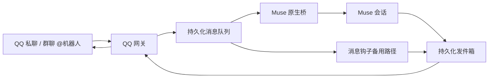

# QQ 通道接入技术方案

日期：2026-10-29  
项目基线：`7e347e6`  
状态：方案阶段，尚未实现或部署。

## 1. 目标与接入方式

为 muse-mobile-channels 增加独立的 QQ 通道，让用户通过 QQ 私聊、群聊中 @机器人与 Muse 对话，并接收文本、附件和审批通知。

参考腾讯官方 OpenClaw QQ 插件的认证、连接和消息处理逻辑，沿用本项目的 Python 技术栈，通过 QQ 官方 WebSocket 接收事件、REST API 发送消息。运行时无须安装 OpenClaw，不引入 OpenClaw 的会话、工具执行或插件生命周期。

参考来源：

- [@tencent-connect/openclaw-qqbot](https://github.com/tencent-connect/openclaw-qqbot)：本次阅读的版本为 `2.0.4`，源码提交 `8998881`。
- [腾讯 QQ Bot Node.js SDK](https://github.com/tencent-connect/qqbot-nodejs)：用于核对认证、网关协议、回复序号、媒体上传与事件结构。

实现时需重新核对引用版本的接口与限制，记录实际采用的版本及差异。

## 2. 功能范围

首版支持：

- QQ C2C 私聊、群聊中 @机器人的消息。
- 文本、图片、文件收发；语音优先使用平台事件中已有的转写，没有转写时明确反馈，不额外部署语音模型。
- `/ping`、`/status`、`/new`、`/stop`、`/queue`、`/help`。
- 使用项目已有 `/a`、`/b`、`/c` 文字命令处理审批。
- 消息持久化、去重、失败重试、重启恢复、运行状态与按需自愈。

首版不包含 QQ 频道、群内自主发言、额外 STT/TTS 服务和 OpenClaw 专属管理命令。主动发送仅在 QQ 平台权限与时效允许的范围内使用，不承诺无限制主动推送。

默认按“机器人 AppID + 会话类型 + 私聊用户或群 ID”隔离 Muse 会话。群内不同成员共享该群的对话上下文，但审批决定与管理命令仍需单独验证操作者权限。同一会话按顺序处理，不同会话不能共享历史或回复地址。

机器人使用显式用户和群白名单；没有配置允许范围时，不将收到的消息交给 Muse 执行。机器人管理员单独配置，审批及管理命令仅向授权管理员开放。

## 3. 数据流与模块设计

### 3.1 QQ 网关

新增 `qq-bot/`，划分配置读取、QQ REST 客户端、WebSocket 协议、消息收发调度与 CLI，避免将全部逻辑集中到单一网关文件。

认证与连接：

- 从仓库外配置读取 AppID、AppSecret，获取并缓存 Access Token，过期前刷新；并发刷新使用互斥，认证失效时按官方错误码处理。
- 查询 QQ 网关地址，处理 HELLO、IDENTIFY、RESUME、事件序列、心跳与 ACK。
- 可恢复断线使用原会话恢复；会话失效后重新认证连接。采用有上限并带随机扰动的退避间隔，防止重连风暴。
- 同一机器人实例使用进程锁，避免两个进程同时消费本地状态。

消息规范化：

- 将私聊与群 @事件转换为统一消息记录，至少包含机器人标识、原始事件 ID、原消息 ID、会话类型、目标 ID、发送者 ID、正文、媒体和时间。
- 去除触发用的机器人提及，保留其他有意义的正文与引用信息。
- 回复地址从持久化的入站路由解析，不接受由模型任意覆盖会话目标。
- 群消息按群白名单与发送者权限检查；非 @消息不触发首版处理。

### 3.2 可靠收发

沿用项目 JSONL、原子状态写入、取消记录和发件结果的约定。

入站先可靠写入 inbox 或桥 spool，再提交去重。并发相同消息互斥；标记单独写入失败时，重启可从已提交队列重建去重。只使用完整 JSONL 行推进读取位置，保留未完成的尾行。

出站保存稳定的本地行 ID、目标、关联原消息 ID、回复序号和分段进度。重试沿用同一逻辑消息及对应序号，不在每次重试时重新生成身份。只有发送成功，或完整载荷已可靠进入重试队列，才能推进源发件游标。

限流和临时网络错误按官方响应退避重试；权限不足、消息过期、格式不支持等永久拒绝需保留失败记录并反馈原因。未知错误保留载荷并进入有界退避，禁止无延迟循环。正式回复不因普通尝试次数耗尽而静默丢弃；确认无法发送时显式记录终态。

平台回执不明与进程崩溃可能形成“请求已送达、结果未落盘”的窗口。使用官方去重字段和回复序号缩小重复风险，验证该窗口的实际行为，不宣称端到端严格 exactly-once。

### 3.3 媒体处理

入站媒体下载限制地址、重定向、体积与超时，防止访问本机、内网或非允许协议。文件写入受控目录，使用安全文件名并校验实际类型；下载失败的消息保留可解释的附件状态。

出站使用 QQ 官方富媒体上传与消息接口。仅允许发送受控目录内文件，限制大小并检查类型；不支持或超出平台限制时明确告知。文本分段及多附件发送记录逐项进度，重试不重复已经确认成功的部分。

### 3.4 Muse 桥接与会话隔离

扩展现有原生桥，使 QQ 按会话维护独立的 FIFO、Muse session、取消记录、主题边界和恢复状态。QQ 会话键由结构化路由生成，文件路径使用安全编码，不能直接拼接外部 ID。

当前桥按渠道维护 worker 和 session，接入 QQ 时不能简单增加一个共享 `qq` 会话。应增加 QQ 会话调度层：每个会话最多一个活动 turn，跨会话采用受限并发；空闲会话释放运行资源，保留恢复所需的持久化状态。微信、企微保留原有行为。

`/new`、`/stop`、`/queue` 仅作用于命令所在会话，管理权限按操作者校验。会话历史和回复结果必须带同一会话键，禁止通过“最新收到的消息”推断回复目标。

原生桥在任务提交前失败时，将消息交给 QQ 收件钩子备用路径；提交后不自动换到另一执行路径，避免重复执行。备用路径同样使用会话隔离和统一的发件箱。

### 3.5 CLI、审批与运维

QQ CLI 提供回复、受控主动发送、状态查询、队列查看、取消与 worker 活动记录，使用文件队列与网关交互，不另开第二条 WebSocket 连接。命令参数和失败退出码保持明确，状态输出不包含凭证。

审批中转增加 QQ 目标适配：审批与发起会话绑定，记录机器人、会话和允许决策的管理员。`/a`、`/b`、`/c` 仅提交给对应待审批项；编号存在不等于有权审批。缺少来源绑定时使用明确配置的管理员私聊，不能默认广播到所有群。

增加 QQ 收件钩子、Linux systemd 服务、状态探针及按需自愈。未配置 QQ 时不启动 QQ 服务，也不影响现有微信、企微部署。macOS 支持前台运行与开发测试，生产服务管理沿用项目现有 Linux 方案。

凭证保存在 `~/.config/qq-bot/credentials.env` 等仓库外目录，限制文件权限。配置示例只使用占位符；截图凭证不写入代码、方案附件、测试、日志或 Git。认证请求、Token 和媒体内容不进入常规日志。

## 4. 实施顺序

1. 固定参考源码版本，整理实际使用的事件、认证、消息与媒体接口及平台限制。
2. 实现独立的 QQ 协议客户端与模拟服务测试，验证认证刷新、心跳、恢复和发送行为。
3. 接入持久化 inbox/outbox、去重、重试、媒体和 CLI，验证存储故障与重启恢复。
4. 扩展 Muse 桥的 QQ 会话调度和钩子备用路径，接入管理命令及审批授权。
5. 补齐配置示例、安装说明、服务与探针，执行端到端沙箱和现有通道回归。

实现过程以独立模块和行为接口为边界，新增函数提供中文文档注释，关键异步边界提供异常处理。无需为接入 QQ 重写现有微信或企微网关。

## 5. 测试与验收

自动化测试使用模拟 QQ 服务和临时状态目录，默认不调用真实机器人：

- Token 过期、并发刷新、认证拒绝、心跳丢失、恢复成功及恢复失败。
- 重复事件、并发同消息、JSONL 半行、入队失败、去重文件失败、重试落盘失败和进程重启。
- 长文本分段、多个附件、部分发送成功、限流、永久拒绝和回执不明。
- 两个私聊、多个群并发，确认历史、回复、取消、队列及 `/new` 全部隔离。
- 白名单拒绝、未授权管理员命令、跨会话审批、附件地址与路径越界。
- 原生桥提交前回退与提交后失败，确认不被双路径重复执行。
- 微信、企微现有相关测试通过，未启用 QQ 的安装行为不变。

真实联调验收：授权用户发消息后经过 QQ 网关、Muse 桥和发件箱，回复返回原会话；图片与文件按平台允许能力收发；断线和重启后未完成消息可恢复；审批只由正确管理员决定。未具备平台权限的能力应报告限制，不能仅凭模拟测试判定可用。

交付物为 QQ 通道实现、回归测试、配置示例和部署说明。代码完成后先在 Linux 沙箱联调，再提供生产部署、状态备份与回退步骤；影响生产的部署需另行确认。
